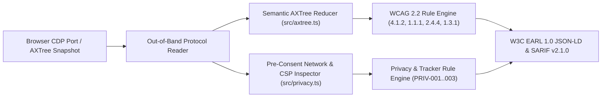

<!-- SPDX-FileCopyrightText: 2026 Mark (malfunctionAI) / KoodiKiht -->
<!-- SPDX-License-Identifier: MIT -->

# `axtree-audit`

**Out-of-band CDP Accessibility Tree (`AXTree`) `WCAG 2.2` verifier and third-party telemetry inspector (`W3C EARL 1.0 JSON-LD` & `SARIF v2.1.0`).**

[](https://github.com/koodikiht/axtree-audit/actions/workflows/ci.yml)
[](https://github.com/koodikiht/axtree-audit/attestations)
[](https://api.reuse.software/info/github.com/koodikiht/axtree-audit)
[](LICENSE)

---

## Problem Statement

Conventional web accessibility scanners (`axe-core`, `pa11y`) inject large JavaScript bundles directly into the inspected DOM context:
1. **Broken under strict CSP**: Pages hardened with strict `Content-Security-Policy` headers block injected evaluation scripts or require weakening production security headers during testing.
2. **DOM vs Screen-Reader Reality Gap**: Assistive technologies (`NVDA`, `Orca`, `VoiceOver`) do not read raw HTML tags; they consume the browser engine's **computed Accessibility Tree (`AXTree`)**. Injected DOM scripts miss engine-level `ignoredReasons`, broken accessibility parent-child ownership, and focusable controls trapped inside `ignored` containers.
3. **Combined Accessibility & Privacy Auditing**: Public-sector and European SME web applications must comply simultaneously with the **European Accessibility Act (`EN 301 549` / `WCAG 2.2`)** and **GDPR / ePrivacy** restrictions on pre-consent third-party tracking.

`axtree-audit` operates **out-of-band** over the browser's debugging protocol (`Accessibility.getFullAXTree` and network telemetry) or offline JSON snapshots. It requires no third-party runtime dependencies and exports standard **W3C EARL 1.0 JSON-LD** and **SARIF v2.1.0** reports.

---

## Architecture (`v0.1.0`)



### Capabilities in `v0.1.0`
1. **Computed `AXTree` Semantic Reducer (`src/axtree.ts`)**:
   - Collapses ignored structural wrappers (`generic`, `none`, `presentation`, `InlineTextBox`) while preserving assistive hierarchy, ARIA landmarks, heading levels, and interactive controls.
   - Detects `WCAG-4.1.2-NAME` (interactive controls with empty computed accessible names), `WCAG-4.1.2-FOCUS-HIDDEN` (focusable elements trapped inside `ignored` AXNodes), `WCAG-1.1.1-IMG` (unlabeled non-decorative images), `WCAG-2.4.4-LINK` (generic link labels), `WCAG-1.3.1-HEADING-ORDER` (skipped heading levels), and `WCAG-1.3.1-LANDMARK` (missing `main` region).
2. **Pre-Consent Network & CSP Privacy Auditor (`src/privacy.ts`)**:
   - Inspects captured network requests and document response headers to flag third-party telemetry/tracker hosts contacted before user consent (`PRIV-003-PRECONSENT-TRACKER`) and missing or permissive `Content-Security-Policy` headers (`PRIV-001`, `PRIV-002`).
3. **Live CDP WebSocket Client (`src/cdp.ts`)**:
   - Connects directly to any running Chromium/browser debugging port (`--cdp http://127.0.0.1:9222`) using native `WebSocket` and fetches the live computed `AXTree` without modifying the page DOM.
4. **Standard Exporters (`src/reporters.ts`)**:
   - `--format earl`: **W3C Evaluation and Report Language (EARL) 1.0 JSON-LD** for automated WCAG conformance pipelines.
   - `--format sarif`: **SARIF v2.1.0** for GitHub Code Scanning / CI gating (`--fail-on-high`).
   - `--format text`: human-readable summary and indented screen-reader tree preview.

---

## Quick Start & Verification

Requires `bun >= 1.1` (or `node >= 22.6` with `--experimental-strip-types`). No external `npm` packages required at runtime.

```bash
# Run offline unit test suite
bun test

# Audit a live browser tab over CDP and print the computed semantic AXTree + WCAG findings
bun run src/cli.ts live --cdp http://127.0.0.1:9222 --url https://example.org

# Audit a saved AXTree + network snapshot and export W3C EARL 1.0 JSON-LD
bun run src/cli.ts scan snapshot.json --format earl > report.earl.json
```

---

## Provenance & Generative AI Policy

Maintained by Mark ([`@malfunctionAI`](https://github.com/malfunctionAI)) at [KoodiKiht](https://koodikiht.dev) (Tallinn, Estonia).

In accordance with **NLnet Foundation Generative AI Policy v2.0 (October 2026)** and EU copyright hygiene:
- All protocol parsers, accessibility tree reducers, test suites, and documentation in this repository are human-authored.
- Generative AI / LLM code generation is not permitted in project contributions (see [`CONTRIBUTING.md`](CONTRIBUTING.md)).

## License

MIT © 2026 Mark (`malfunctionAI`) / KoodiKiht. Compliant with [FSFE REUSE 3.2](https://reuse.software/).
